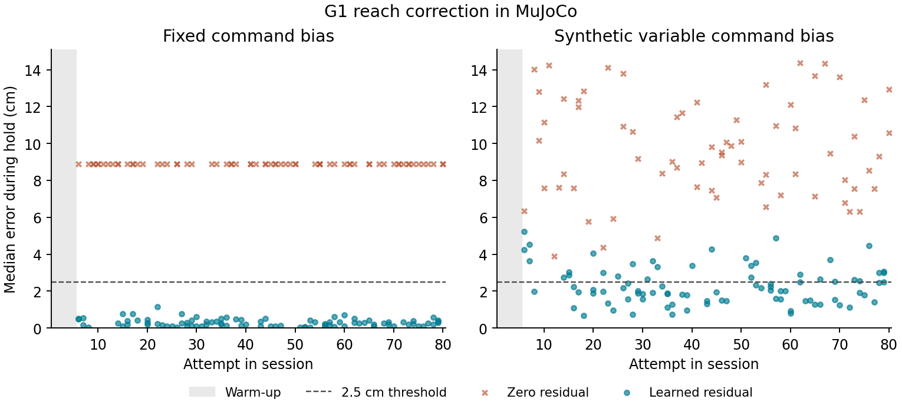

# ATLAS simulation investigation

The public ATLAS release describes how a humanoid adapts a motion from one human demonstration video and a language instruction. Its VLM specifies the task, SAM 3 and RGB-D locate the contact target, and a frozen ScaleBFM controller tracks the adapted whole-body reference. An online dynamics ensemble and learned residual actor correct the hand command. Vision and geometric progress checks drive retries, and the VLM revises perception phrases and success checks using saved observations. [ATLAS method, sections 2.1–2.5](https://atlas-humanoid.github.io/blog/)

## What we reproduced

- The released ScaleBFM M checkpoint replayed a whole-body G1 squat in MuJoCo.
- With the published fixed command bias, a local correction improved the calibrated apple pick from **0/15 to 15/15 lifts**. Across nine starting poses it improved first-attempt lifts from **3/9 to 4/9**. Retries added zero lifts in that matched comparison.
- In a separate diagnostic, the first miss moved the apple **2.29 cm** and the harness lifted it **65.47 cm** on attempt two with continuous physics state.

[Architecture and test-time learning](docs/architecture.md) · [Browser replay](viewer/index.html) · [Diagnostic recording](results/scalebfm_floor_pick_retry_diagnostic.mp4)

## Public resources

| Resource | Release status as of 2026-11-18 |
| --- | --- |
| [ATLAS project website](https://atlas-humanoid.github.io/) and [methods write-up](https://atlas-humanoid.github.io/blog/) | The write-up is cited as an early release. I found no standalone ATLAS paper PDF or arXiv entry. |
| [ATLAS GitHub organization](https://github.com/atlas-humanoid) | The only listed public repository is the [project website source](https://github.com/atlas-humanoid/atlas-humanoid.github.io). I found no public ATLAS harness implementation or runnable experiment package. |
| [ScaleBFM paper](https://arxiv.org/abs/2607.15163) and [PDF](https://arxiv.org/pdf/2607.15163v1) | The paper for the upstream motion tracker. |
| [ScaleBFM source](https://github.com/zengweishuai/ScaleBFM) and [pretrained checkpoints](https://huggingface.co/WeishuaiZeng/ScaleBFM/tree/main/checkpoint) | ScaleRetarget prepares Unitree G1 motions, ScaleTrack runs Isaac Lab playback, and ScaleBridge runs MuJoCo playback with a GPU-specific TensorRT export in its documented workflow. |
| [Isaac Lab-Arena](https://github.com/isaac-sim/IsaacLab-Arena) | A public benchmark and simulation framework with a [G1 loco-manipulation workflow](https://isaac-sim.github.io/IsaacLab-Arena/release/0.2.1/pages/example_workflows/locomanipulation/index.html). |

These pins identify the public resources used in the investigation. The downloaded copies live under the Git-ignored `resources/` directory.

| Local resource | Provenance |
| --- | --- |
| `resources/atlas-website/blog/index.html` | [ATLAS website repo](https://github.com/atlas-humanoid/atlas-humanoid.github.io), commit `16e8e122d066c268b23f28fc570a2ff34998a5a0` |
| `resources/scalebfm-paper.pdf` | [Author-hosted PDF](https://scalebfm.github.io/assets/paper/paper.pdf), retrieved from the project site repository and verified against Git blob `1259d7abad9592323b48769d96b304168606bc39`. |
| `resources/ScaleBFM` | [ScaleBFM repo](https://github.com/zengweishuai/ScaleBFM), commit `abd6f17c02fe0baabc14709feb8d9ea4959aa621` |
| `resources/ScaleBFM-models` | [Hugging Face release](https://huggingface.co/WeishuaiZeng/ScaleBFM/tree/233b72d29a42bd7e8ea809dfd7aaf22c4c96b57b), via the HF mirror. The checkpoint SHA-256 is `88d5a79946c03ed25503f48b2af71d16290844ef066ca9b6c8fa8dc3837422e3`. |

## Reproduce from a fresh checkout

The following downloads are sufficient for the whole-body runs. The upstream ATLAS website and ScaleBFM paper are available through the public links above.

```bash
mkdir -p resources/ScaleBFM-models
git init resources/ScaleBFM
git -C resources/ScaleBFM fetch --depth=1 \
  https://github.com/zengweishuai/ScaleBFM.git abd6f17c02fe0baabc14709feb8d9ea4959aa621
git -C resources/ScaleBFM checkout --detach FETCH_HEAD

model_base=https://hf-mirror.com/WeishuaiZeng/ScaleBFM/resolve/233b72d29a42bd7e8ea809dfd7aaf22c4c96b57b
model_dir=resources/ScaleBFM-models
curl -fL "$model_base/checkpoint/humanoid_transformer_m/model_22200.pt" \
  -o "$model_dir/model_22200.pt"
for filename in mode_table.pt model_22200_tensorrt_metadata.json; do
  curl -fL "$model_base/compiled_checkpoint/humanoid_transformer_m/linux/$filename" \
    -o "$model_dir/$filename"
done
sha256sum -c <<'CHECKSUMS'
88d5a79946c03ed25503f48b2af71d16290844ef066ca9b6c8fa8dc3837422e3  resources/ScaleBFM-models/model_22200.pt
fca11f2399bced32517b51c7f9dcf13c97117ca469b0b32e207d8f7d664fbde9  resources/ScaleBFM-models/mode_table.pt
3024f18136314fade2676e22d6eafb1a8b2befa388da55b0885a53fcb1368d16  resources/ScaleBFM-models/model_22200_tensorrt_metadata.json
CHECKSUMS
```

The tested environment was Python 3.10.20 with CUDA-enabled PyTorch 2.13.0+cu130. Install a [PyTorch build compatible with your GPU](https://pytorch.org/get-started/locally/) and the following packages in the same environment.

```bash
python -m pip install mujoco==3.11.0 numpy==2.2.6 scipy==1.15.3 \
  hydra-core==1.3.4 omegaconf==2.3.1 loguru==0.8.0 \
  imageio==2.37.4 imageio-ffmpeg==0.6.0 glfw==2.10.2
```

From the checkout root, run `python -B sim/scalebfm_playback.py` for the squat or `python -B sim/floor_pick_retry.py --output /tmp/atlas-retry.csv` for the matched pose comparison. Open `viewer/index.html` directly for the browser replay. The native replay uses the committed state archive and the pinned ScaleBFM robot assets.

## CPU simulation results

[sim/reach.py](sim/reach.py) uses the existing TWIST2 Unitree G1 MJCF and simulates seven right-arm joints with the pelvis and all other joints fixed. The arm tracks a scripted Cartesian reach via inverse kinematics and joint torque control at 50 Hz, holds for 0.5 s, and resets to the same pose between attempts. The test fits an affine dynamics model from observed hand positions and applies a rate- and amplitude-limited residual using a 12-step prediction. The learner sees the pre-bias command and hand position, with the injected bias applied inside the simulated controller.

Each case runs 80 attempts for each of three seeds. After five exploration attempts per seed, attempts are randomly assigned to learned correction, zero residual, or further exploration. The fixed case uses the authors' reported 7.9 cm short and 4.1 cm right offsets. The variable case adds independent Gaussian noise with an assumed 2.5 cm standard deviation per axis per attempt. A hit means the median hand error during the hold is within 2.5 cm. [ATLAS fixed- and variable-bias experiment descriptions](https://atlas-humanoid.github.io/#sim)

| Bias | Learned residual | Zero residual | Attempt data |
| --- | ---: | ---: | --- |
| Fixed | 0.26 cm median, 88/88 hits | 8.89 cm median, 0/69 hits | [CSV](results/fixed_bias.csv) |
| Synthetic variable | 2.03 cm median, 57/88 hits | 9.46 cm median, 0/69 hits | [CSV](results/synthetic_variable_bias.csv) |



The results measure reach correction on a fixed-base arm with a linear learner and a scripted target. The published benchmarks use whole-body ScaleBFM tracking, a neural ensemble and actor, and contact and lift success. This test leaves video processing, perception, balance, grasping, lift, and retry in place untested.

### Run locally

The existing `gmr` environment provides MuJoCo 3.11.0 and NumPy 2.2.6. The script defaults to `../gensong_gmr/TWIST2-master/assets/g1/g1_sim2sim_29dof.xml` relative to the workspace. Use `--mjcf` to point to another copy of that XML with its meshes available. The tested XML SHA-256 is `8e185a84604f2a05eaa6f13efd96bc162a68368b933605fb164e8159cd3593d2`.

```bash
OPENBLAS_NUM_THREADS=1 ~/miniconda3/envs/gmr/bin/python sim/reach.py
OPENBLAS_NUM_THREADS=1 ~/miniconda3/envs/gmr/bin/python sim/reach.py \
  --bias-std-m 0.025 --output results/synthetic_variable_bias.csv
```

## Whole-body reproduction

The original restricted session hid the NVIDIA device files. With Full Access, the workspace shell detects the RTX 5060 Laptop GPU with 8,151 MiB of VRAM and driver 595.91.07, and PyTorch completed a CUDA tensor operation. The laptop is below NVIDIA's published 16 GB VRAM minimum for Isaac Sim 5.1.0. Single-environment headless playback in Isaac Sim remains untested. [Isaac Sim 5.1.0 requirements](https://docs.isaacsim.omniverse.nvidia.com/5.1.0/installation/requirements.html)

### ScaleBFM squat playback

The released M checkpoint completed all 417 frames (8.34 s at 50 Hz) of the bundled G1 squat in headless MuJoCo with whole-body mode enabled. The simulated pelvis descended to 0.331 m and returned to 0.784 m. The corresponding reference minimum and final heights were 0.218 m and 0.779 m. Median joint-angle RMSE was 0.104 rad, and peak PyTorch CUDA allocation was 80.8 MiB. [Frame-by-frame results](results/scalebfm_squat.csv) · [Pelvis-height plot](results/scalebfm_squat.png)

[sim/scalebfm_playback.py](sim/scalebfm_playback.py) uses the pinned upstream policy wrapper and ScaleBridge simulation environment. The adapter bypasses TensorRT compilation for eager PyTorch inference and disables the MuJoCo viewer. The test covers the released tracker and its example motion. The squat uses local reference tracking and contains no object or ATLAS task harness.

The run used the existing `gmr` environment and Loguru 0.8.0 installed to `/tmp/atlas-playback-deps`. With that dependency available, run from this workspace.

```bash
PYTHONPATH=/tmp/atlas-playback-deps OPENBLAS_NUM_THREADS=1 \
  ~/miniconda3/envs/gmr/bin/python -B sim/scalebfm_playback.py
```

### Isaac Lab benchmark

On a machine with GPU access and sufficient VRAM, start with ScaleTrack's sample-motion checkpoint playback using its documented Python 3.11, Isaac Sim 5.1.0, and pinned Isaac Lab revision. That verifies the upstream tracker and simulation asset path. [ScaleTrack setup and checkpoint playback](https://github.com/zengweishuai/ScaleBFM/blob/main/ScaleTrack/README.md)

Matching the published results requires the ATLAS reference motions, hand and object configurations, bias distribution, learner settings, and evaluation code or enough release detail to reconstruct them. [ATLAS evaluation](https://atlas-humanoid.github.io/#sim)

### Apple floor pick in MuJoCo

[sim/floor_pick.py](sim/floor_pick.py) combines the released ScaleBFM M checkpoint with a scripted crouch, reach, hold, close, and lift. It edits the bundled squat with wrist-pose IK to build the reference. At runtime the frozen tracker drives all 29 G1 joints at 50 Hz with world-frame tracking. Two simulated sliding pads close on a free, 68 mm diameter sphere representing the apple and lift it through contact and friction. The target is the initial, known apple center.

The nominal setup lifted the apple **66.42 cm** before the bias was added. During the comparison, both conditions use the same fixed wrist reference calibration of **5.5 cm back, 1.5 cm left, and 13.0 cm down**, tuned on nominal probes for this squat and gripper. Both receive the authors' command bias of **7.9 cm short and 4.1 cm right**. The learned condition fits a two-axis affine model to the measured horizontal hand position near the end of each hold and uses it to choose the next bounded correction. The model begins with five exploration attempts per seed and learns from the wrist command and hand position. [ATLAS fixed-bias protocol](https://atlas-humanoid.github.io/#sim)

| Condition | Lifts | Median horizontal hold error | Median 3D hold error | Median peak apple rise |
| --- | ---: | ---: | ---: | ---: |
| Zero correction | 0 / 15 | 2.79 cm | 3.95 cm | 0.00 cm |
| Learned correction | 15 / 15 | 1.49 cm | 3.93 cm | 66.86 cm |

A lift requires the apple to stay at least 10 cm above its initial height with simultaneous contact on both pads for at least 0.20 s. Three seeds each ran 20 attempts with five warm-up attempts followed by five cycles of control, learned correction, and further exploration. The scene and bias were fixed throughout. The control repeats the same deterministic condition, and the seeds vary the exploration sequence. The results cover this calibrated scene. This experiment resets the scene between attempts. The retry study below uses a continuous scene within each episode. ATLAS's video and perception pipeline and neural learner remain untested.

[Corrected pick video](results/scalebfm_floor_pick_corrected.mp4) · [Control and learned traces](results/scalebfm_floor_pick.png) · [All 60 attempts](results/scalebfm_floor_pick.csv)

Run a single seed from the workspace root using the same environment as the squat playback. Use seeds 0, 1, and 2 with different output filenames to repeat the three sessions.

```bash
PYTHONPATH=/tmp/atlas-playback-deps MUJOCO_GL=egl OPENBLAS_NUM_THREADS=1 \
  ~/miniconda3/envs/gmr/bin/python -B sim/floor_pick.py --seed 0 --attempts 20 \
  --output /tmp/atlas-floor-pick-seed0.csv --video /tmp/atlas-floor-pick-seed0.mp4 --video-attempt 7
```

### Retry in place

[sim/floor_pick_retry.py](sim/floor_pick_retry.py) runs the same scripted pick and frozen whole-body tracker with a live-state retry loop. On a failed lift it opens the gripper and continues the rise and retract motion. Once the robot is upright and the apple is near the floor, it reads the apple's current position from MuJoCo and replans the next reach. The robot keeps its stance. The episode stops on a lift, a fall, an unstable recovery, an apple outside the configured reach area, or the attempt limit. The simulator resets at the start of each episode. Each retry records matching physics-state hashes and timestamps across the attempt boundary, and the tracker retains its observation history.

The comparison used nine matched starting poses on a 7 cm by 7 cm grid, the original fixed horizontal bias, and up to three attempts per episode. The learned condition started each episode with the same five warm-up observations collected at the grid center and updated its fit during that episode. The sphere has explicit floor rolling resistance for this test. The lift check requires the previous 10 cm and 0.20 s threshold and verifies that the apple remains held at the end of the clip.

| Condition | First-attempt lifts | Lift within three attempts | Falls |
| --- | ---: | ---: | ---: |
| Zero correction | 3 / 9 | 3 / 9 | 0 / 9 |
| Learned correction | 4 / 9 | 4 / 9 | 0 / 9 |

The logs verify 21 retries from live state. In the forward zero-correction episode, the first miss moved the apple 13.10 cm, and the second attempt targeted the updated position. None of the nine matched scenes gained a lift from the extra attempts. The fixed stance, current grasp geometry, and horizontal learner still limit recovery as the apple moves.

[Episode summary](results/scalebfm_floor_pick_retry.csv) · [Attempt logs and state hashes](results/scalebfm_floor_pick_retry_attempts.csv)

In a separate diagnostic, the first gripper closure was deliberately skipped. Contact with the open gripper moved the apple 2.29 cm. The harness re-aimed and lifted it on attempt two. The diagnostic is outside the matched comparison. [Continuous episode video](results/scalebfm_floor_pick_retry_diagnostic.mp4) · [Diagnostic attempt log](results/scalebfm_floor_pick_retry_diagnostic_attempts.csv)

The [native MuJoCo replay](sim/view_floor_pick_retry.py) opens the recorded simulation states with a freely movable camera. Drag with the left mouse button to orbit, right-drag to pan, and scroll to zoom. Press Space to play or pause, T to jump to attempt two, R to restart, and the bracket keys to step. The viewer starts paused.

```bash
PYTHONPATH=/tmp/atlas-playback-deps OPENBLAS_NUM_THREADS=1 \
  ~/miniconda3/envs/gmr/bin/python -B sim/floor_pick_retry.py \
  --output /tmp/atlas-floor-pick-retry.csv

PYTHONPATH=/tmp/atlas-playback-deps MUJOCO_GL=egl OPENBLAS_NUM_THREADS=1 \
  ~/miniconda3/envs/gmr/bin/python -B sim/floor_pick_retry.py \
  --case right --skip-first-close --output /tmp/atlas-retry-diagnostic.csv \
  --video /tmp/atlas-retry-diagnostic.mp4 --video-case right

PYTHONPATH=/tmp/atlas-playback-deps OPENBLAS_NUM_THREADS=1 \
  ~/miniconda3/envs/gmr/bin/python -B sim/view_floor_pick_retry.py
```
