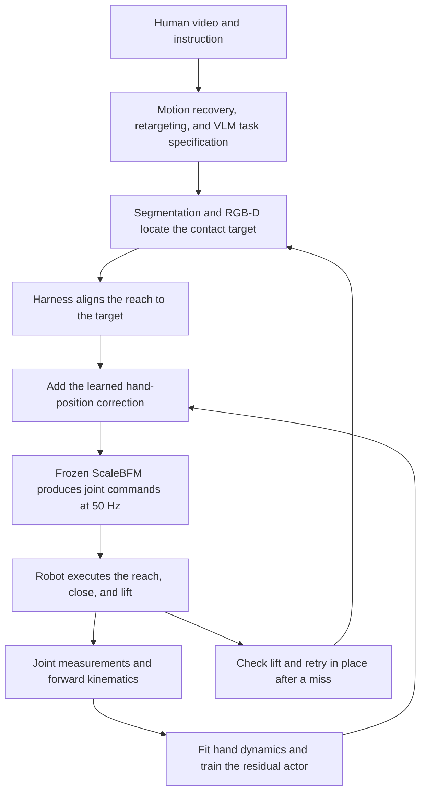

# ATLAS architecture and test-time learning

ATLAS composes a vision-language agent, perception, a task execution harness, and the frozen ScaleBFM whole-body controller. A human demonstration supplies a motion reference. The task specifies how to use that reference in the robot's current scene. [ATLAS method](https://atlas-humanoid.github.io/blog/)

## Data flow

The agent specifies the task phases, end effector, grasp affordance, search phrase, and completion condition. During navigation the frozen tracker receives planned references. Once a pick starts it receives the adapted human motion reference. The harness controls grasp timing, lift checks, and retries. [Task specification](https://atlas-humanoid.github.io/blog/#spec) · [Whole-body tracking](https://atlas-humanoid.github.io/blog/#wbc)

## The fast learning loop

At each control tick the learner distinguishes three quantities. The target is the desired contact-point position, the command is that target plus the actor's residual, and the measured hand position comes from forward kinematics. A short reach can provide useful training data even when the grasp fails. The first five attempts explore around a zero residual.

ATLAS fits an ensemble of dynamics networks to predict the next hand position from the current measured position and the command. It then differentiates through rollouts of that model to train an actor that reduces predicted hand error during the hold and penalizes rapid changes in the residual. During execution, the actor reads the live hand position and target and emits a bounded change to the residual each tick. ScaleBFM translates the resulting kinematic reference into coordinated body motion using the original weights. The task harness also issues finger close and open commands as part of the grasp sequence. [Fast learning method](https://atlas-humanoid.github.io/blog/#fast)

The slower perception loop can revise a segmentation phrase or a progress check. The agent evaluates the revision against saved observations before deploying it. A revised phrase may change the estimated target position. The actor's residual only changes the commanded hand position relative to that target. [Slow learning method](https://atlas-humanoid.github.io/blog/#slow)

## ScaleBFM context and lineage

The released ScaleBFM M checkpoint uses three recent robot-state samples and the intervening actions, along with six reference frames. Three state samples at 50 Hz span 40 ms. This gives the tracker short-horizon feedback for motion control. Across-attempt observations live in the ATLAS learner's training data. A transformer that adapts in context across attempts would need an interface for those trajectories and training or validation that establishes it uses them to improve the next reach. [ScaleBFM architecture](https://arxiv.org/html/2607.15163v1#A4) · [ScaleBridge policy inputs](https://github.com/zengweishuai/ScaleBFM/blob/abd6f17c02fe0baabc14709feb8d9ea4959aa621/ScaleBridge/README.md#migrate-the-policy)

ScaleBFM follows Zeng et al.'s original *Behavior Foundation Model for Humanoid Robots* and trains its transformer for reference tracking with on-policy RL. LeCAR's BFM-Zero is a separate research line that trains a promptable latent space using unsupervised RL and forward-backward representations. [Original BFM](https://arxiv.org/abs/2509.13780) · [ScaleBFM](https://arxiv.org/abs/2607.15163) · [BFM-Zero](https://arxiv.org/abs/2511.04131)

## How the investigation maps to ATLAS

- [Fixed-base arm](../sim/reach.py) fits a linear tick-by-tick dynamics model and uses short rollouts to select a Cartesian correction.
- [Whole-body floor pick](../sim/floor_pick.py) uses the released ScaleBFM checkpoint, an edited squat reference, and a simple simulated gripper. Its learner fits a linear response from horizontal hand position near the end of each hold and selects a correction for the next attempt.
- [Live-state retries](../sim/floor_pick_retry.py) release and retract after a miss and reacquire the apple from MuJoCo ground truth. The matched pose sweep added zero lifts through retries. A separate interrupted-grasp diagnostic lifted on the second attempt.
- Open components include video motion recovery and retargeting, VLM task generation and revisions, camera-based grounding, and the authors' neural ensemble and within-reach actor.

[Experiment results and reproduction steps](../README.md)
